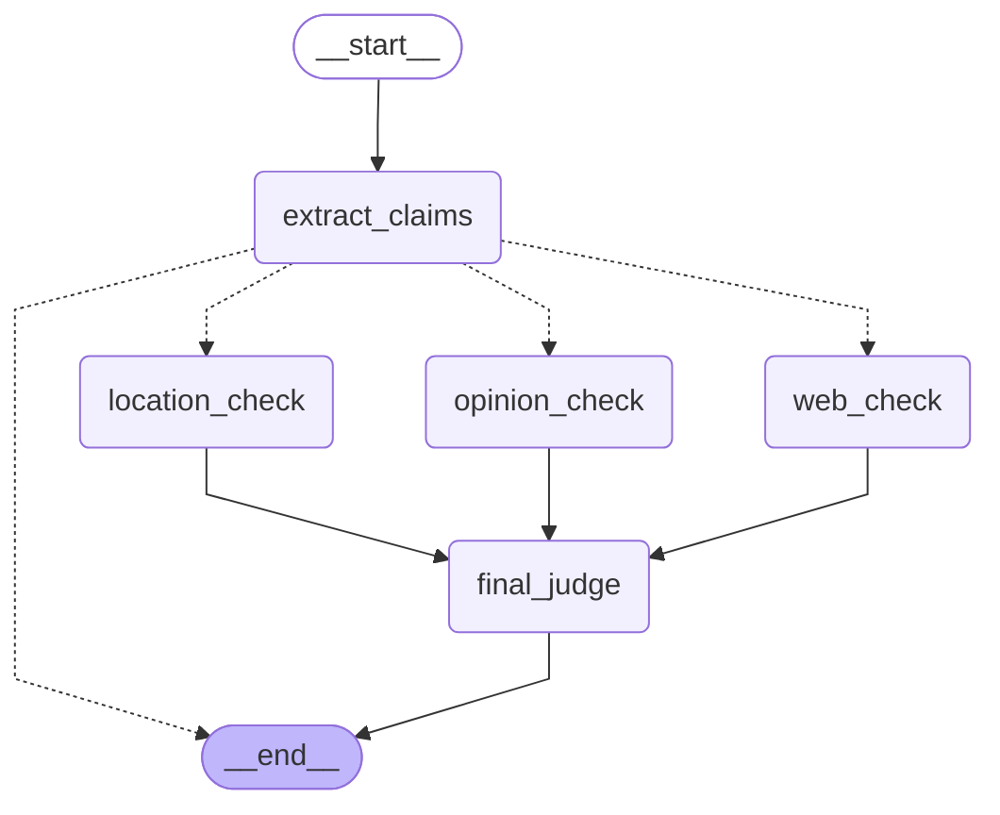
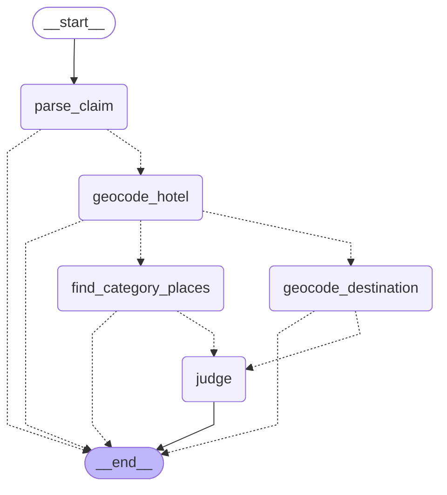
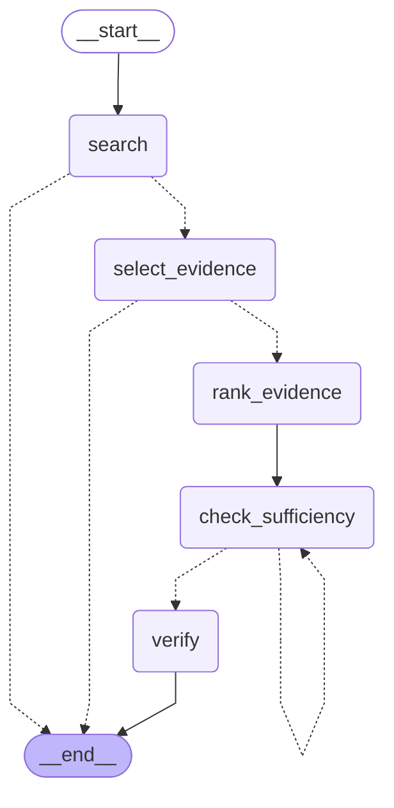
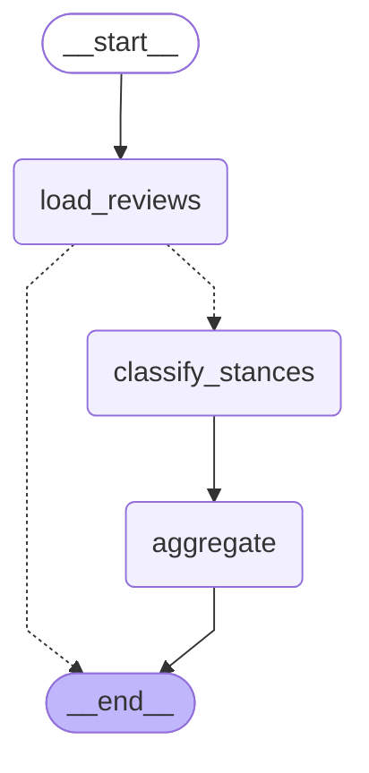

# Pipeline graphs

Generated from the compiled LangGraph graphs with `python graph.py`.

## Review graph

## Location checker (`location_check`)

## Web search checker (`web_check`)

## Opinion checker (`opinion_check`)

